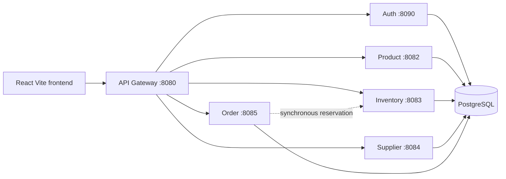

# Architecture

Services are independently deployable Spring Boot applications. PostgreSQL is shared as an infrastructure instance, while tables are owned by service schema prefixes. Flyway runs on service startup. The gateway contains only routing and cross-origin policy; domain logic stays in the owning service.
